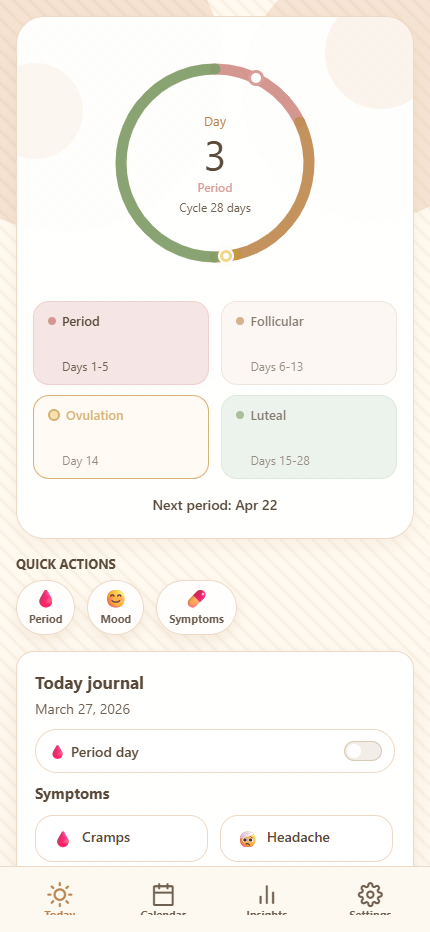
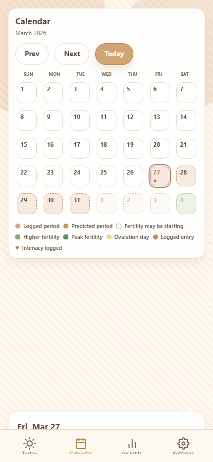
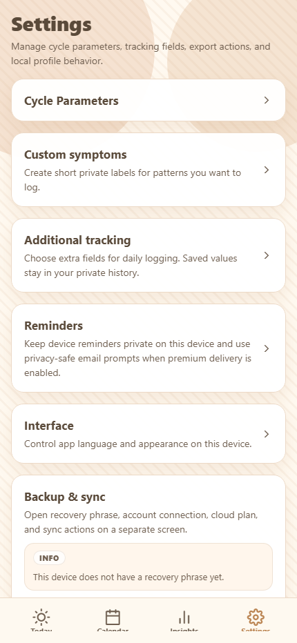
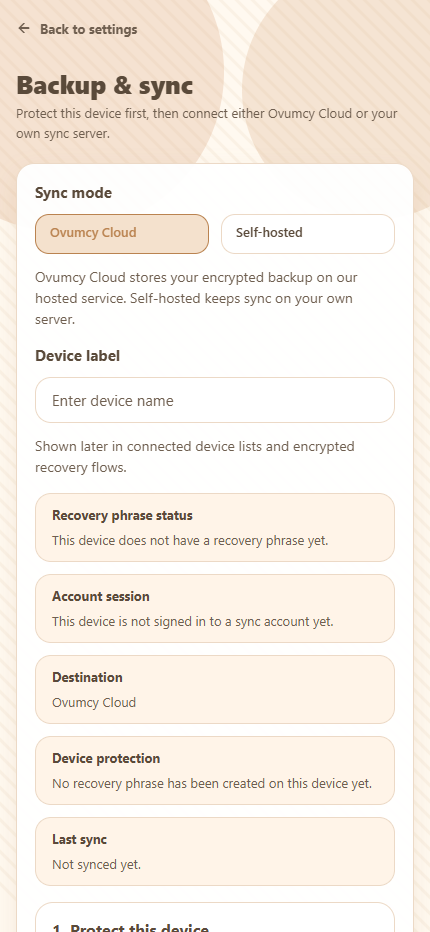
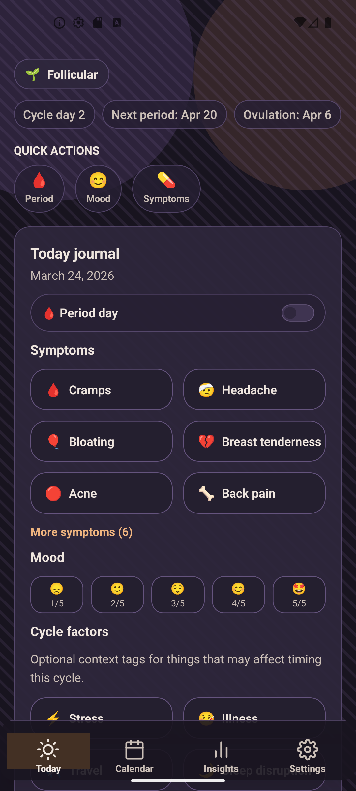
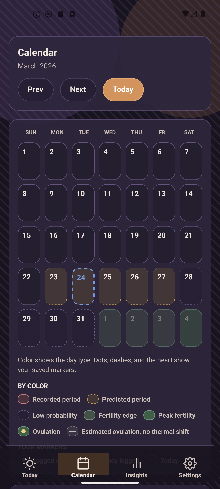
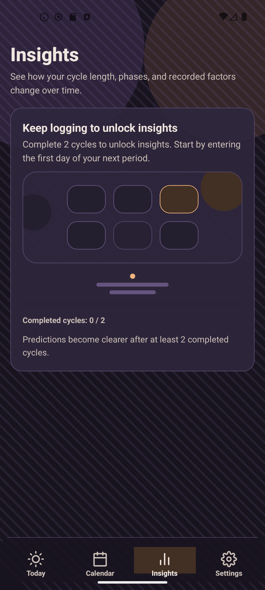
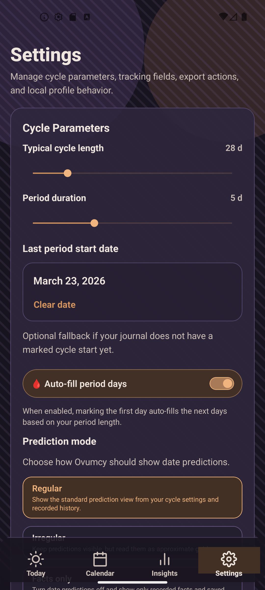
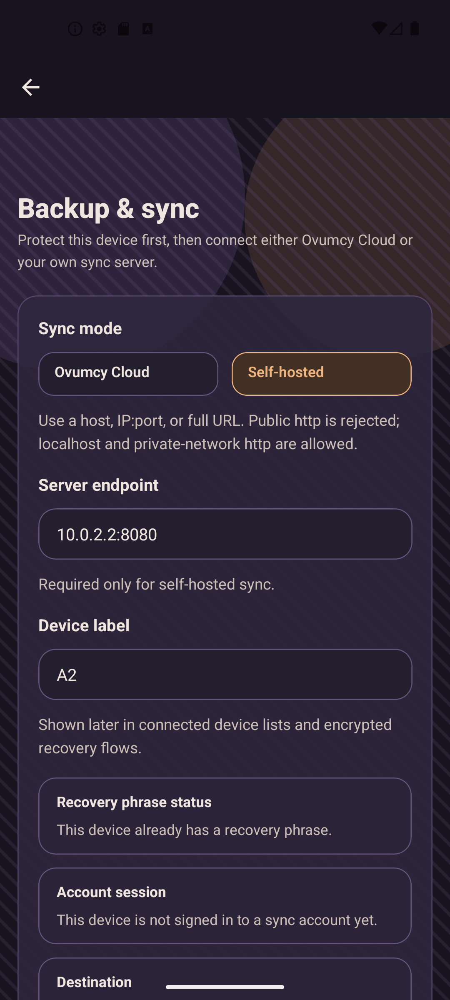

<p align="center">
  
</p>

<p align="center">
  <strong>A private menstrual cycle tracker for your phone. Your data stays on your device.</strong>
</p>

<p align="center">
  <a href="https://github.com/ovumcy/ovumcy-app/actions/workflows/ci.yml?query=event%3Amerge_group"></a>
  <a href="https://github.com/ovumcy/ovumcy-app/actions/workflows/security.yml"></a>
  <a href="https://github.com/ovumcy/ovumcy-app/actions/workflows/codeql.yml"></a>
  <a href="https://securityscorecards.dev/viewer/?uri=github.com/ovumcy/ovumcy-app"></a>
  <a href="https://app.codecov.io/gh/ovumcy/ovumcy-app"></a>
  <a href="TESTING.md"></a>
</p>

<p align="center">
  <a href="#project-status"></a>
  <a href="https://expo.dev/"></a>
  <a href="https://reactnative.dev/"></a>
  <a href="https://polyformproject.org/licenses/noncommercial/1.0.0/"></a>
  <a href="#privacy-and-security"></a>
  <a href="#architecture"></a>
  <a href="#privacy-and-security"></a>
  <a href="https://mastodon.social/@ovumcy"></a>
</p>

<p align="center">
  <a href="#quick-start">Quick Start</a> ·
  <a href="#features">Features</a> ·
  <a href="#screenshots">Screenshots</a> ·
  <a href="#tiers">Tiers</a> ·
  <a href="https://ovumcy.com">ovumcy.com</a>
</p>

Ovumcy App is a menstrual cycle tracker for iOS and Android that keeps your health data on the phone in your hand. Period dates, symptoms, and fertile-window estimates are stored on the device, encrypted at rest, and never leave it unless you switch on sync yourself.

- **No account.** Install, go through a two-step onboarding, and start logging. Tracking, predictions, statistics, reminders, and export all work with no sign-up and no network.
- **Your device is the storage.** Native SQLite with encrypted-at-rest health records and a device-local key in the platform secure store.
- **No strings.** No analytics, no ad trackers, no telemetry. CSV and JSON export whenever you like, and an offline JSON import to bring it back.

> ⭐ **If Ovumcy is useful to you, star the repository.** Stars are how people looking for a private cycle tracker find it. More ways to help: [Support the Project](#support-the-project).

This README describes the current `main` branch. The app is an early public alpha with no tagged release yet; see [Project Status](#project-status).

## Contents

- [Quick Start](#quick-start) · [Screenshots](#screenshots)
- [Why Ovumcy App](#why-ovumcy-app) · [Features](#features) · [How Predictions Work](#how-predictions-work)
- [Reminders](#reminders) · [Supported Languages](#supported-languages) · [Tiers](#tiers)
- [Privacy and Security](#privacy-and-security) · [Accessibility](#accessibility) · [Short FAQ](#short-faq)
- [Project Status](#project-status) · [Roadmap](#roadmap)
- [Architecture](#architecture) · [Tech Stack](#tech-stack) · [Testing and Quality](#testing-and-quality)
- [Development](#development) · [Related Projects](#related-projects) · [Contributing](#contributing)
- [Support the Project](#support-the-project) · [License](#license)

## Quick Start

Requirements:

- Node.js 22+
- npm 11+ (npm 10 resolves the lockfile's range-keyed overrides differently, so its `npm ci`
  rejects the lockfile)
- Android Studio for Android emulator work
- Xcode on macOS for iOS simulator work

```bash
git clone https://github.com/ovumcy/ovumcy-app.git
cd ovumcy-app
npm ci
```

Run the app:

```bash
npm run android
npm run ios
npm run web
```

`npm run web` starts a browser preview for fast review. It keeps data in session-only memory and is not a durable or secure place for real health data; use a native build for that.

## Screenshots

| Today | Calendar |
| --- | --- |
|  |  |

| Settings | Backup & sync |
| --- | --- |
|  |  |

<details>
<summary>Dark theme</summary>

| Today | Calendar | Insights |
| --- | --- | --- |
|  |  |  |

| Settings | Backup & sync |
| --- | --- |
|  |  |

</details>

## Why Ovumcy App

Most cycle trackers start with a cloud account and lean on analytics and third-party services you never see. Ovumcy App goes the other way: the phone is the whole product, and anything that leaves it is opt-in and end-to-end encrypted.

The table compares broad product models rather than specific brands, since privacy and export policies shift too often to pin to names.

| Capability | Ovumcy App | [Ovumcy web](https://github.com/ovumcy/ovumcy-web) (self-hosted) | Cloud-first tracker |
| --- | --- | --- | --- |
| Works with no account | :white_check_mark: | Account on your own server | :x: |
| Works offline | :white_check_mark: | :x: needs your server | Varies |
| Nothing to host or maintain | :white_check_mark: | :x: | :white_check_mark: |
| No telemetry or ad trackers by default | :white_check_mark: | :white_check_mark: | Varies |
| Open data export (CSV / JSON) | :white_check_mark: | :white_check_mark: | Varies |
| Where the data lives | Your device, encrypted at rest | Your server | Vendor cloud |
| Multiple devices | Optional end-to-end encrypted sync | Any browser | :white_check_mark: |

Choose the app for an on-device tracker; choose `ovumcy-web` when you want one server reachable from any browser.

## Features

Everything in this list is free, works offline, and needs no account.

- Log the day: period days, flow intensity and spotting, symptoms, mood, sex, basal body temperature, cervical mucus, pregnancy tests, cycle factors such as stress, illness, or travel, and free-form notes.
- Your own custom symptoms alongside the built-in ones; archiving a symptom hides it from new entries and keeps it on past days.
- Turn off what you do not track (temperature, cervical mucus, sex, cycle factors, notes) and pick °C or °F.
- Predictions for your next period, ovulation, fertile window, and cycle phase, with a plain-language explanation of how the estimate is made, plus modes for irregular or unpredictable cycles.
- A positive pregnancy test pauses predictions until a later period start is logged.
- Calendar and statistics views for spotting patterns over months.
- On-device reminders to log the day, before your next period, and before the fertile window; see [Reminders](#reminders).
- CSV and JSON export, and an offline JSON import that previews first and never overwrites a day you already logged.
- Device authentication (Face ID, Touch ID, fingerprint, or device passcode) before destructive or sensitive actions, and screen-capture protection that is on by default.
- Light, dark, or system theme, and a week that starts on Monday or Sunday.
- English, Russian, Spanish, French, German, and Italian.

Optional, on top of the free core:

- **Encrypted backup and sync** between your own devices through a self-hosted [`ovumcy-sync-community`](https://github.com/ovumcy/ovumcy-sync-community) server, or through Ovumcy Cloud.
- **Ovumcy Cloud** (paid): advanced fertility signals, premium cycle insights, extended reports, a doctor-friendly PDF, and read-only partner sharing. See [Tiers](#tiers).
- **Pregnancy, postpartum, and mood check-in module**: pregnancy mode with due-date tracking, a kick counter and contraction timer, postpartum recovery tracking, and an EPDS mood check-in with crisis-support information. It is planned as a one-time unlock rather than a subscription; the purchase path is not live yet, see [Project Status](#project-status).

The free owner flows follow `ovumcy-web` as their UX reference; the contract the app is checked against is in [docs/web-parity-checklist.md](docs/web-parity-checklist.md).

## How Predictions Work

The app works out ovulation, the fertile window, and your next period from the dates you log, with the same calendar math as `ovumcy-web`. There are no sensors and no hormone readings involved:

- Your next period is your last period start plus your typical cycle length (the median of your recent cycles, or the length you set).
- Ovulation is counted back from there. The luteal phase, from ovulation to the next period, is treated as about 14 days by default and refined toward your own value when your temperature or cervical-mucus entries allow, so ovulation lands near cycle length minus the luteal length.
- The fertile window is the six days ending on ovulation day.
- A positive pregnancy test pauses predictions until a later cycle start is logged. While a pregnancy record is active, predictions stay hidden until that record is closed.

These are estimates, not medical advice and not a form of contraception, and they get less reliable for irregular cycles.

The full algorithm, with every constant, edge case, and worked example, is in [docs/cycle-prediction.md](docs/cycle-prediction.md). The worked examples are checked by reference tests, so the document and the code stay in sync.

## Reminders

Reminders are scheduled and delivered by the phone's own notification system. No server and no push service are involved, so they work offline and with sync turned off.

- **Daily log** — a nudge to record the day.
- **Upcoming period** — shown the number of days ahead you choose in Settings (0–14, default 3).
- **Fertile window** — one day before the estimated fertile window starts.

Notification text is deliberately generic: it names no dates, phases, or health details, so nothing sensitive appears on a lock screen. The dates themselves are shown inside the app, with the same estimate-not-medical-advice framing as every other prediction surface.

`ovumcy-web` also offers webhook reminders and a private calendar (`.ics`) subscription. Both depend on a server that is always online, so the app does not carry them; local notifications cover the same need on a phone.

## Supported Languages

| Language | Code |
| --- | --- |
| English | `en` |
| Russian | `ru` |
| Spanish | `es` |
| French | `fr` |
| German | `de` |
| Italian | `it` |

All six are full first-party localizations, the same set as `ovumcy-web`. The language can be switched in Settings at any time.

## Tiers

Ovumcy is layered so each level adds capability without taking anything away from the one below.

| Tier | Backend | Cost | What you get |
| --- | --- | --- | --- |
| **Free (local)** | none | free | Everything under [Features](#features): tracking, custom symptoms, predictions, statistics, reminders, CSV/JSON export, offline JSON import |
| **Community Sync** | self-hosted `ovumcy-sync-community` | free, your hosting | Everything in Free + encrypted backup and restore between your own devices |
| **Ovumcy Cloud** | managed hosted service | paid, 30-day trial on signup | Everything above + advanced fertility signals, premium cycle insights, extended cycle reports, doctor-friendly PDF, partner sharing |

| Capability | Free | Community Sync | Ovumcy Cloud |
| --- | --- | --- | --- |
| Works without an account | :white_check_mark: | :x: (server account) | :x: (cloud account) |
| Local-first device storage | :white_check_mark: | :white_check_mark: | :white_check_mark: |
| Cycle tracking and predictions | :white_check_mark: | :white_check_mark: | :white_check_mark: |
| Pregnancy test with prediction pause | :white_check_mark: | :white_check_mark: | :white_check_mark: |
| Local device reminders | :white_check_mark: | :white_check_mark: | :white_check_mark: |
| CSV / JSON export | :white_check_mark: | :white_check_mark: | :white_check_mark: |
| Offline JSON import / restore (additive) | :white_check_mark: | :white_check_mark: | :white_check_mark: |
| Encrypted backup between devices | :x: | :white_check_mark: | :white_check_mark: |
| Advanced fertility signals (LH, BBT shift, ovulation confirmation) | :x: | :x: | :white_check_mark: |
| Premium cycle insights (weighted average, drift, anomalies, seasonal, short luteal warning) | :x: | :x: | :white_check_mark: |
| Extended cycle reports | :x: | :x: | :white_check_mark: |
| Doctor-friendly PDF with colored calendar | :x: | :x: | :white_check_mark: |
| Partner sharing (one-way, read-only view for a free guest) | :x: | :x: | :white_check_mark: |
| Pregnancy / postpartum / check-in module | separate one-time unlock, works on any tier | | |

Health data stays end-to-end encrypted across all three tiers. The cloud only sees opaque ciphertext, account session metadata, and billing snapshot signals.

The pregnancy, postpartum, and mood check-in module sits **outside** this ladder: it is a one-time unlock on the device itself and needs no account or sync at any point. A cloud subscription neither grants nor revokes it, and the reverse holds too. Data already logged with it — pregnancy records, kick and contraction sessions, postpartum records, check-in results — stays readable and exportable regardless of what any purchase or plan says later; ownership is consulted only when starting new tracking. Its crisis-support information is never gated.

## Privacy and Security

- No telemetry or ad trackers by default. Core onboarding, tracking, predictions, statistics, reminders, and export work without sync or cloud access.
- Native profile, day-log, and symptom data live behind a SQLite-backed repository with encrypted-at-rest payloads and a device-local key in secure storage. The key uses `AFTER_FIRST_UNLOCK_THIS_DEVICE_ONLY` accessibility, so at-rest encryption protects a powered-off or not-yet-unlocked device — not an already-unlocked, seized, or otherwise compromised device (see [SECURITY.md](SECURITY.md)).
- The web preview uses a non-persistent in-memory storage adapter, so browser reloads do not retain health data.
- Sync secrets are stored wrapped in secure storage only; non-secret sync preferences stay in canonical local storage. Auth tokens, recovery secrets, and sync credentials are never kept in AsyncStorage or other broadly readable key/value stores.
- Recovery phrases are shown only during explicit local setup or rekey flows and are exported through an explicit local artifact flow instead of the clipboard.
- Self-hosted and managed sync encrypt health payloads before upload. Sync servers store ciphertext, device metadata, and auth/session metadata, not decrypted health content. See [docs/sync-trust-model.md](docs/sync-trust-model.md).
- Transport uses standard TLS with platform CA-chain trust; certificate pinning is scaffolded but not yet wired. Payload confidentiality against a CA-compromise adversary therefore relies on the end-to-end payload encryption, not on pinning — while connection metadata and auth tokens would be exposed to such an adversary. The decided strategy pins the Let's Encrypt ISRG root keys for the managed endpoint; pin set, rotation rule, and pre-release checklist: [docs/sync-trust-model.md](docs/sync-trust-model.md#tls-pinning-posture).
- Managed cloud auth and billing are a separate plane from sync transport.
- Cloud accounts (managed and self-hosted) support optional TOTP two-factor authentication for login; see [docs/two-factor.md](docs/two-factor.md).
- Local CSV, JSON, and PDF exports are privacy-sensitive artifacts and should be handled like health-data backups.
- Automated checks in GitHub Actions cover a production dependency audit, Trivy filesystem scanning, and CodeQL; Dependabot monitors app dependencies and GitHub Actions.

The threat model, the security invariants, and the claim-to-test enforcement table are in [SECURITY.md](SECURITY.md). If you found a security issue, see its reporting section.

## Accessibility

- Interactive controls carry an accessibility role, an accessible name sourced from the same localized copy the screen renders, and the state that matters (`disabled`, `selected`, `checked`, `expanded`). Option groups (single-choice tiles, symptom chips) are named by the field label above them, so a radio or checkbox announces which question it answers.
- Informational rows that read as one fact — a stats panel, a calendar legend entry, a partner-shared day, a metric caption and its figure — are announced as one element instead of a run of disconnected fragments. Purely decorative chrome is kept out of the accessibility tree.
- Screen and section titles expose the header role, so a rotor can jump between "what screen am I on" and each section.
- OS font scaling (Dynamic Type / Android font size) is honored: `allowFontScaling` is never switched off, so body copy grows with the system setting without limit. Fixed-geometry surfaces — the calendar month grid, the stats bar chart, the dashboard cycle hero, and compact one-line chrome — cap `maxFontSizeMultiplier` at a named tier (`src/ui/theme/tokens.ts`) so a very large system font shrinks-to-fit inside its own cell instead of overlapping a neighbour.
- Automated coverage: per-surface screen tests assert names, roles, and states on actionable elements; a policy test pins the font-scaling caps on the dense surfaces; the Playwright web smoke walks onboarding, day logging, calendar, stats, and settings at an enlarged font scale and fails on clipped calendar cells or horizontal overflow.
- Not automated: real screen-reader passes. VoiceOver and TalkBack reading-order checks, plus the OS "larger text" settings, are part of the manual acceptance pass in [docs/manual-smoke.md](docs/manual-smoke.md).

## Short FAQ

### Does Ovumcy App require an account?

No. Onboarding, daily tracking, predictions, statistics, reminders, local CSV/JSON export, and offline JSON import all work without an account.

### Where is the data stored?

On the device. Native platforms use a local SQLite-backed repository with encrypted-at-rest payloads for health records. Nothing leaves the phone unless you turn on sync, export a file, or share with a partner yourself.

### Is sync required?

No. Sync is optional: a self-hosted community server or a managed Ovumcy Cloud account, both alpha integrations. Core tracking does not depend on either.

### Can the sync server read health data?

The sync transport is designed so the server stores ciphertext, not readable health records. The server may still see account/session metadata, attached device metadata, blob-size metadata, and timestamps. See [docs/sync-trust-model.md](docs/sync-trust-model.md).

### Can I export my data?

Yes. Export to CSV or JSON from Settings at any time, with no account. A JSON export can be imported back on the same or another device; the import shows a preview first and never overwrites a day that already exists.

### Does Ovumcy App use telemetry or ad trackers?

No. There is no analytics, crash-reporting, or advertising SDK in the app.

### Is there a free trial of Ovumcy Cloud?

Yes. Signing up for Ovumcy Cloud starts a 30-day trial that unlocks all premium features, roughly one cycle, so the doctor PDF, advanced insights, and partner sharing can be evaluated on real data before any billing.

### How does partner sharing work?

Partner sharing is owner-paid only — the partner never pays and never tracks their own cycle through the share. The owner picks an access level (summary or full) in backup-and-sync settings and generates a single-use invite link with a 7-day invite token TTL, which can also be shown as a QR code. The partner installs the app, opens the link or scans the QR, and lands in a read-only shared view shaped by the chosen access level; the cloud only stores ciphertext plus grant metadata.

A no-account guest accept path is implemented on both the app and managed sides but is **not enabled in production yet** — it stays gated until platform-verified deep links (Android App Links / iOS Universal Links) are live, so an intercepted invite link cannot be redeemed by a stranger. Until then, accepting an invite uses a free Ovumcy Cloud sign-in step. See [docs/sync-trust-model.md](docs/sync-trust-model.md#guest-partner-access) and [docs/deep-links.md](docs/deep-links.md).

### Is Ovumcy App a medical product?

No. Ovumcy provides tracking and estimates based on recorded data. It is not a medical device and should not be treated as diagnostic or treatment advice.

Period and fertile-window predictions in particular are statistical estimates derived from the cycle data you log. They are not a contraceptive method, a fertility treatment, or a substitute for medical care.

## Project Status

`ovumcy-app` is an early public alpha. What is already true on `main`:

- every free owner flow works as a local-first slice on-device: onboarding, dashboard, calendar, day logging, statistics, custom symptoms, reminders, settings, export, and offline import;
- Ovumcy Cloud premium surfaces are wired client-side: without an active plan they show as cleanly locked (never a silent hide, never an error), and they render fully when the managed billing snapshot reports premium features active;
- community and managed sync have encrypted round-trip integration suites; those live suites run only against a configured server (`OVUMCY_SYNC_LIVE_BASE_URL` / `OVUMCY_MANAGED_LIVE_BASE_URL`) and are skipped by default, so they are not part of the routine CI signal;
- the pregnancy, postpartum, and mood check-in module is implemented and tested end to end, including backup, sync, and export of its records.

What the repository does **not** claim yet:

- **in-app purchases.** Paid Ovumcy Cloud plans are to be provisioned by app-store billing, Google Play Billing first and App Store second (see [ovumcy-managed/docs/adr-monetization.md](https://github.com/ovumcy/ovumcy-managed/blob/main/docs/adr-monetization.md)); until that lands, premium cannot be purchased on-device. The same applies to the pregnancy module's one-time unlock: release builds cannot unlock it yet, and only development builds can exercise it;
- validated non-English wording for the EPDS mood check-in; until it exists, the check-in is ready for English only;
- a production-enabled no-account guest landing for partner sharing (see the FAQ above);
- completed Android and iOS manual smoke discipline for every release candidate, and release-store readiness for broad distribution.

## Roadmap

Near-term:

- Google Play Billing, then App Store, so a real subscription drives the managed billing snapshot and TestFlight / Play internal testing can validate premium with sandbox purchases;
- the store purchase path for the pregnancy module's one-time unlock;
- validated EPDS translations for the five non-English locales;
- enabling the already-built no-account guest acceptance flow once platform-verified deep links are live;
- closing the remaining free-tier feature gaps against `ovumcy-web`;
- repeatable Android and iOS manual smoke per release candidate.

## Architecture

```text
iOS App / Android App / Web Preview
                 |
                 v
          App Services Layer
                 |
                 v
         Local Storage Boundary
                 |
                 v
 Native SQLite / Web session-only memory storage

Optional sync:
Local Sync Setup -> Account/Auth Transport -> Self-hosted or managed sync service
```

- `app/`: Expo Router route files and navigation only.
- `src/models/`: canonical domain types and product shapes.
- `src/services/`: reusable product logic and view-data assembly.
- `src/storage/`: local repositories, persistence contracts, and migrations.
- `src/ui/`: shared design tokens and visual primitives.
- `src/ui/screens/`: screen-level presentation and feature-local screen sections.
- `src/sync/`: optional sync contracts, endpoint policy, and setup orchestration.
- `src/security/`: device, secure-storage, and crypto policy for local-data, sync, and partner-share envelopes.
- `src/i18n/`: localized copy catalogs and the language runtime (en, ru, de, fr, es, it).

The sync trust model is documented in [docs/sync-trust-model.md](docs/sync-trust-model.md).

## Tech Stack

- Expo, React Native, Expo Router, TypeScript
- expo-sqlite for native local persistence
- @noble/ciphers (XChaCha20-Poly1305) for sync envelope encryption
- pdf-lib for client-side doctor PDF generation
- Jest and React Native Testing Library; fast-check for property tests
- Playwright for the web-preview smoke; Maestro for native flows ([docs/e2e-maestro.md](docs/e2e-maestro.md))

## Testing and Quality

Common local commands:

```bash
npm run lint
npm run typecheck
npm test
npm run doctor
npm run e2e:web
```

The automated baseline:

- `lint`, `typecheck`, and `expo-doctor`;
- Jest screen, service, and storage tests, with reference tests that check the worked examples in [docs/cycle-prediction.md](docs/cycle-prediction.md);
- `fast-check` property tests for the payload and partner-share crypto (`src/security/*.property.test.ts`);
- opt-in live sync round-trips (`src/sync/*.live.test.ts`), skipped unless a live server is configured;
- the Playwright web smoke for onboarding and the app shell;
- a production dependency audit, Trivy filesystem scanning, CodeQL, and Dependabot updates for `npm` and `github-actions`.

The full quality approach is in [TESTING.md](TESTING.md); manual acceptance guidance is in [docs/manual-smoke.md](docs/manual-smoke.md).

Deployment tooling:

- `npm run deploy` pins `eas-cli` to an explicit version via npx (`eas-cli@18.4.0`), not `@latest`. (eas-cli is not a project dependency, so it is not in the lockfile.)
- The `production` EAS build profile carries `EXPO_PUBLIC_ENTITLEMENT_PUBKEYS` (the entitlement `kid -> public key` map — public by construction; it ships inside every client artifact anyway). Native production builds pick it up from `eas.json`; a web deploy runs outside that profile, so export the same value in the deploy shell — otherwise the release guard stops the deploy rather than let the placeholder key ship.

## Development

- Implement product logic in `src/services/` and `src/models/`.
- Keep persistence in `src/storage/`.
- Keep route files thin.
- Use `ovumcy-web` as the canonical UX reference for the free owner flows.

## Related Projects

- [`ovumcy-web`](https://github.com/ovumcy/ovumcy-web) — the self-hosted web application and server: one server, a browser UI reachable from any device.
- [`ovumcy-sync-community`](https://github.com/ovumcy/ovumcy-sync-community) — optional self-hosted encrypted sync for the app. Add it only when you want backup, restore, or multi-device sync on your own server.
- Ovumcy Cloud — the managed hosted backend behind the paid tier (auth, billing, partner sharing).

## Contributing

See [CONTRIBUTING.md](CONTRIBUTING.md) and the [Code of Conduct](CODE_OF_CONDUCT.md). For bugs and feature requests, open a [GitHub issue](https://github.com/ovumcy/ovumcy-app/issues). Release notes accumulate in [CHANGELOG.md](CHANGELOG.md).

## Support the Project

Ovumcy has no ads or trackers. If it is useful to you:

- **Star the repository** ⭐ — the simplest way to help others find the project.
- **Report bugs and share ideas** in [GitHub Issues](https://github.com/ovumcy/ovumcy-app/issues).
- **Help with translations** — see [Supported Languages](#supported-languages) and [CONTRIBUTING.md](CONTRIBUTING.md).
- **Tell a friend** who wants a cycle tracker that keeps their data on their phone.

Want to support Ovumcy with a donation? Crypto options are on [ovumcy.com/support](https://ovumcy.com/support). If none of them works for you, write to [contact@ovumcy.com](mailto:contact@ovumcy.com).

## License

Ovumcy App is source-available under the **PolyForm Noncommercial License 1.0.0**.
You may view, self-host, use, and modify it for any noncommercial purpose, and
share it noncommercially. Commercial use — selling it, offering it as a paid
service, or bundling it into a paid product — is not granted; contact Ovumcy for
a commercial license.
See [LICENSE](LICENSE).

Third-party attribution notices are recorded in [NOTICE.md](NOTICE.md).
