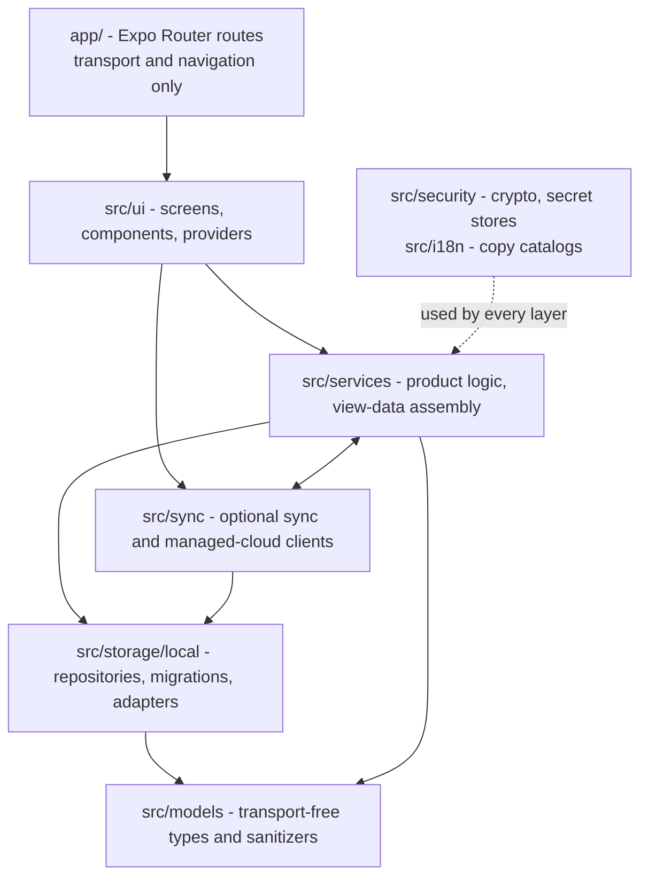

# Architecture

Ovumcy is a privacy-critical, local-first React Native / Expo client for a
menstrual and fertility tracker. Special-category health data lives on the
device. Core tracking, predictions, stats and local CSV/JSON export work with no
account, sync or hosted service; sync is an optional layer on top.

This document is a map of the **internal layering**, the **boot sequence**, the
**storage backend** and the **lifecycle of a user action**. The security
controls it names are the test-backed claims in [`SECURITY.md`](../SECURITY.md)
and the sync design in [`docs/sync-trust-model.md`](sync-trust-model.md); this
file points at them and does not restate them. Test layers are described in
[`TESTING.md`](../TESTING.md), cycle-prediction rules in
[`docs/cycle-prediction.md`](cycle-prediction.md).

## Layers

| Layer | Path | Responsibility |
| --- | --- | --- |
| Routes | `app/` | One thin file per route (`export default function XRoute() { return <XScreen /> }`); the root layout `_layout.tsx` also holds the providers and the stack navigator. No domain logic, no persistence. |
| UI | `src/ui` | Screens (`src/ui/screens`), components, the app-wide preferences provider, the confirm-dialog bridge, theme tokens, tab navigation. Holds feature UI state only. |
| Services | `src/services` | Reusable product logic: cycle prediction and day-log policies, view-data builders per screen, export/import, reminders, entitlement and billing reads. Takes a `LocalAppStorage` (and secret stores) as arguments. |
| Sync | `src/sync` | Optional sync and managed-cloud clients, endpoint and password policy, snapshot build/restore. Reads and writes local data only through `LocalAppStorage`. |
| Storage | `src/storage/local` | The only layer that knows the persistence backend. |
| Models | `src/models` | Record types and `sanitize*`/`normalize*` helpers with no I/O. |
| Cross-cutting | `src/security`, `src/i18n` | Payload encryption and secret stores; per-surface copy catalogs and language resolution. |

Dependency rules:

- Routes import screens; they do not import services or storage. The one exception is the root
  layout `app/_layout.tsx`, which also runs the boot-time export-artifact sweep
  (`src/services/export-artifact-cleanup`) and applies screen-capture protection
  (`src/security/app-screen-protection`).
- Screens call services and pass them `appStorage`. They never import a concrete
  storage adapter; only tests do, to construct fixtures.
- Services depend on the `LocalAppStorage` interface in
  `src/storage/local/storage-contract.ts`, never on SQLite. Nothing above
  `src/storage` branches on the persistence technology.
- Sync is never required by a core local flow. A service that needs a session
  reads sync preferences and secrets and degrades to the local path when they
  are absent. `src/services` and `src/sync` are peers that import each other
  (for example `sync-setup-service` uses services, and
  `managed-partner-share-sync-service` uses `sync-setup-service`), so there is no strict order between them.
- Storage reaches up only for pure helpers: the adapters import the sanitizers
  in `src/services/day-log-policy.ts`, `onboarding-policy.ts` and
  `profile-settings-policy.ts`, and the sync preference types in
  `src/sync/sync-contract.ts`. None of these perform I/O.
- No layering rule is enforced mechanically by a lint rule or script; the
  structure is held by review and by the tests running services against the
  storage interface.

### Platform splits

Where behaviour differs per platform, a module is split by extension and Metro
picks the variant per target. Most splits are `{native,web}.ts` with a `.d.ts`
declaring the shared shape: `platform-local-app-storage`, the
`platform-*-store` secret stores in `src/security`, and `export-delivery`,
`export-artifact-cleanup` and `import-file-picker` in `src/services`. Two
differ: `platform-local-reminder-scheduler` has a plain `.ts` default beside its
`.native.ts` and `.web.ts`, and `export-pdf-runtime` has a plain `.ts` (native)
plus a `.web.ts` override.

## Boot sequence

1. `index.js` first imports the web invite-token scrub
   (`src/security/web-invite-token-scrub-bootstrap.ts`), so the token is removed
   from `window.location` before any router code reads the URL. It then renders
   the expo-router app.
2. `app/_layout.tsx` (`RootLayout`) starts the export-artifact sweep in a mount
   effect: `cleanupStaleExportArtifacts()` removes leftovers from the platform
   cache. On native it deletes files whose names start with `ovumcy-export-` or
   `ovumcy-private-export-` plus the document-picker cache directory, and it
   swallows failures. A process kill mid-share bypasses the delivery code's
   `try/finally`, which is why the sweep runs on boot. The web variant is a
   no-op counterpart for the preview build.
3. `AppPreferencesProvider` reads the profile record through `appStorage` and
   resolves the interface language and theme overrides and the screen-capture
   protection flag. `RootNavigator` applies `useAppScreenProtection`, mounts the
   confirm-dialog provider and declares the `Stack`.
4. `app/index.tsx` renders `AppEntryScreen`, which calls
   `resolveInitialEntryHref` in `src/services/app-bootstrap-service.ts`. That
   reads the bootstrap state and returns `/(tabs)/dashboard` when onboarding is
   complete and `/onboarding` otherwise; the screen does a `router.replace`.
5. `app/(tabs)/_layout.tsx` renders `ProtectedTabsLayout`, which re-reads the
   onboarding flag and, once onboarding is complete, refreshes managed
   partner-share projections on mount and whenever the app returns to the
   foreground (best-effort; failures are swallowed).

`appStorage` is created once in `app-bootstrap-service.ts` through
`createPlatformLocalAppStorage()`. The first storage call hydrates the database
(see below); there is no separate start-up migration step.

## Request flow: saving a day log

The day-log editor on the dashboard and calendar autosaves. The path of one
edit:

1. **UI.** `DayLogEditorCard` edits a draft in `CalendarScreen` or
   `DashboardScreen`. `useDayLogAutosave`
   (`src/ui/screens/day-log/use-day-log-autosave.ts`) debounces the draft
   (`DAY_LOG_AUTOSAVE_DEBOUNCE_MS`, 700 ms), tracks a draft version so a stale
   save does not overwrite a newer edit, and reports saving, saved and failed
   states with localized labels.
2. **Service.** The screen passes
   `saveDayLogEditorRecord(storage, record)`
   (`src/services/day-log-editor-service.ts`) as `onPersist`. It reads the
   profile and symptom records, runs `sanitizeDayLogRecord` with the symptom ids
   filtered to known symptoms, loads the neighbouring records relevant to
   period auto-fill, and decides whether to auto-fill the period window or clear
   previously auto-filled neighbours. It then writes each affected day with
   `storage.writeDayLogRecord`. A storage error is caught and returned as
   `{ ok: false }`; the UI shows the failed state rather than throwing.
3. **Storage.** In the SQLite adapter, `writeDayLogRecord` is queued on a
   serialized operation queue and awaits the reset barrier. `upsertDayLogRecord`
   sanitizes the record again, derives an opaque row key (a SHA-256 over
   namespace, the local-data key and the date, so the `day` column does not hold
   the calendar date), and upserts the row. The plaintext shadow columns receive
   the empty-record defaults; the real values exist only inside
   `encrypted_payload`, produced by `encryptLocalDataRecord` with the table name
   and row key bound as associated data.
4. **Back in the UI.** `onSaved` refreshes the screen's view data (prediction
   and calendar inputs are recomputed from storage), re-syncs the local reminder
   schedule, and calls `syncManagedPartnerSharedProjections`, which returns
   without side effects unless a managed session with partner access exists.

Reads follow the same path in reverse: screen, `*-view-service` or
`*-screen-service`, repository read, decrypt, `sanitize*`.

## Storage

### Interface and adapters

`LocalAppStorage` (`storage-contract.ts`) is a single repository interface:
bootstrap state, profile, sync preferences, onboarding, day logs, symptoms,
managed billing cache, pregnancy, kick and contraction sessions, postpartum
records, screening responses, and `clearAllLocalData`. It has three
implementations of the same interface:

| Adapter | Used when |
| --- | --- |
| `sqlite-app-storage.ts` (expo-sqlite, `ovumcy-local.db`) | Native builds, via `platform-local-app-storage.native.ts`, a process-wide singleton on `globalThis` so a re-evaluated bundle does not open a second connection. |
| `volatile-web-app-storage.ts` (in-memory) | Web preview, via `platform-local-app-storage.web.ts`. State lives in a closure and is lost on reload. The web key store is also in-memory. Preview is not durable or strongly protected storage. |
| `async-storage-app-storage.ts` | Not a runtime backend. Only its read/clear helpers are used as the *legacy source* for a one-time import into SQLite (below). |

### Encrypted payloads

Each row of the SQLite tables carries an `encrypted_payload` column holding a
JSON envelope (algorithm tag `xchacha20poly1305`, nonce, ciphertext) over the
JSON-serialized record. The key is a random 32-byte device-local key held in
platform secure storage (`expo-secure-store`, after-first-unlock, this device
only; in memory on web). The associated data binds the table name and row key
(`ovumcy-local-v1|<table>|<row key>`), so ciphertext cannot be moved between
rows or tables. The remaining plaintext columns are the minimum needed to
select rows (for example a `status` or a `day`), or defaults. See
[`SECURITY.md`](../SECURITY.md) for the threat model, accepted residual risks
and the test matrix; the primitives are in `src/security/payload-crypto.ts` and
`local-data-crypto.ts`.

### Schema and migrations

`sqlite-schema-migrations.ts` owns the DDL and `ensureLocalAppSchema`. There is
no migration runner keyed on `PRAGMA user_version`. Every hydrate runs the whole
sequence:

- `CREATE TABLE IF NOT EXISTS` for the base tables;
- reconcile steps per table that add missing columns with `ALTER TABLE ... ADD
  COLUMN`, treating a "duplicate column name" error as already applied;
- idempotent `CREATE TABLE IF NOT EXISTS` steps for tables added later
  (managed billing cache v13, pregnancy tables v14, postpartum v15, screening
  v16);
- a final `PRAGMA user_version = DATABASE_VERSION` (currently 16), which records
  the version but does not select which steps run.

Schema changes are additive: a new column or table is added as another
idempotent step and its version constant is bumped. Three steps do touch
existing data: the legacy `onboarding_profile` table is folded into
`profile_settings` once and then dropped, `bootstrap_state.profile_version` is
updated on every hydrate, and plaintext rows are re-encrypted in place (see
Hydration).

### Hydration

`createSQLiteAppStorage` lazily hydrates the database on first use, in this
order: open the database and wrap it in a serialized queue; `ensureLocalAppSchema`;
resolve the local-data key (below); import legacy AsyncStorage data if SQLite
has no bootstrap or profile row; encrypt any rows still stored as plaintext
(`migratePlaintextLocalDataRows`); seed the singleton rows. One retry is made
when the native open fails with an invalid-handle error. All operations run
through a queue, and `clearAllLocalData` raises a reset barrier so that no read
or write interleaves with the wipe.

### Key mismatch reset

`resolveLocalDataKey` (`sqlite-local-data-key.ts`) reads the key from secure
storage and canary-decrypts the first non-empty payload in `bootstrap_state`,
then `profile_settings`. If decryption fails (for example the database was
restored without the key, or the key was regenerated), it wipes every local
table with `wipeLocalAppTables`, generates and stores a new key, and continues.
If there is no stored key but encrypted rows exist, it wipes them before
creating a key. The wipe covers all tables, not only the two canary tables. The
result is a fresh, usable install rather than a crash or partially readable
data. A user-initiated "delete all local data" uses the same wipe, then clears
the legacy store and the key and reseeds.

## Entitlements

Two independent entitlement sources exist, and neither grants or revokes the
other. The rules
are in [`SECURITY.md`](../SECURITY.md) and
[`docs/sync-trust-model.md`](sync-trust-model.md); only the shape is given here.

- **Managed billing.** Premium surfaces (advanced fertility, advanced insights,
  doctor PDF, extended reports, partner access) read the managed
  billing snapshot through `src/services/managed-premium-features-service.ts`.
  The snapshot requires a managed sync mode and a present managed session. When
  the live fetch fails at the transport level (no response, or a 5xx), a
  persisted last-known-good copy is served to display surfaces — never to
  server-checked paths, and never after an explicit refusal — for a bounded
  window (`MANAGED_BILLING_CACHE_TTL_MS`, 72 hours), stored encrypted in
  `managed_billing_cache`. The snapshot also carries a `reminders` flag, which
  nothing gates on. A verified signed entitlement token, read through
  `EntitlementTokenGate`, overrides the snapshot for the two purely local
  features (doctor PDF, advanced insights); the gate is built on the production
  path but is inert until the managed cloud issues tokens, so today the snapshot
  values stand. Baseline
  tracking, local analytics, CSV/JSON export and local reminders are never gated.
- **Pregnancy module.** Ownership is a one-time on-device unlock resolved by
  `loadPregnancyModuleOwned` in `src/services/pregnancy-entitlement-service.ts`.
  It fails closed: a source error or any non-`true` answer reads as not owned.
  The only source today is a build flag honored in development builds only; a
  release build resolves to not owned. It gates starting new pregnancy data and
  rendering pregnancy-mode surfaces, not reads or exports of data already logged.

## Optional sync

`src/sync` is a pluggable layer. It holds the sync contract and preference
types (`sync-contract.ts`), the HTTP clients for a self-hosted community server
and the managed cloud, endpoint and password policy, certificate pinning,
account session, recovery and TOTP services, and snapshot build/restore. It
reaches local data only through `LocalAppStorage` and keeps secrets in the
platform secret stores in `src/security`, never in the SQLite database. Sync
preferences themselves are an ordinary encrypted record in `sync_preferences`
(default mode `managed`, setup status `not_configured`). The sync and managed
cloud base URLs default to the project hosts and can be overridden at build time
with `EXPO_PUBLIC_OVUMCY_SYNC_BASE_URL` and `EXPO_PUBLIC_OVUMCY_MANAGED_BASE_URL`.
Setup, sign-in and backup flows are reached from the backup-sync routes
(`app/backup-sync.tsx`, `app/sync-account-security.tsx`) and the services behind
them. The trust model, key handling and envelope rules are in
[`docs/sync-trust-model.md`](sync-trust-model.md).

## i18n runtime

There is no external i18n library or runtime catalog loader. Each surface has a
typed copy module in `src/i18n` (for example `day-log-copy.ts`,
`dashboard-copy.ts`) exporting a `get<Surface>Copy(language)` function that
returns the strings for one of the six supported languages: English, Russian,
Spanish, German, French and Italian. `runtime.ts` resolves a language: a locale
tag is reduced to its primary subtag and normalized, with English as the
fallback, and `resolveDeviceLanguage` reads the device locale through `Intl`.
`resolveEffectiveLanguage` picks the active language: the profile's language
override when set, the device language otherwise (English when the device
language is unsupported). `AppPreferencesProvider` supplies it to screens and
the doctor PDF uses it for its labels. Russian
plural forms come from `ru-plural.ts`. Services that produce user-visible text
take a language or locale argument instead of reading global state.

## Testing seams

Detail on suites and commands is in [`TESTING.md`](../TESTING.md). The seams the
architecture provides:

- **Storage interface.** Services and screens accept a `LocalAppStorage`
  argument (screens default to `appStorage`). Tests pass an in-memory adapter or
  the mock in `src/test/create-local-app-storage-mock.ts`; the SQLite adapter
  takes an injectable `openDatabase`, `localDataKeyStore` and
  `legacyStorageSource`.
- **Secret stores.** Sync, partner-share, entitlement-token and local-data key
  stores are interfaces with injectable fakes (`src/test`, in-memory key store).
- **Clock and platform flags.** Services take `now` or `isDevelopment`-style
  options with real defaults.
- **Providers.** Screen tests wrap components in
  `src/test/AppPreferencesTestProvider.tsx`.
- **Platform splits.** Native and web variants have their own test files
  (`*.native.test.ts`, `*.web.test.ts`).
- **End-to-end.** The Playwright web smoke test in `e2e/` drives the web export
  against the in-memory adapter; Maestro flows are described in
  [`docs/e2e-maestro.md`](e2e-maestro.md).
